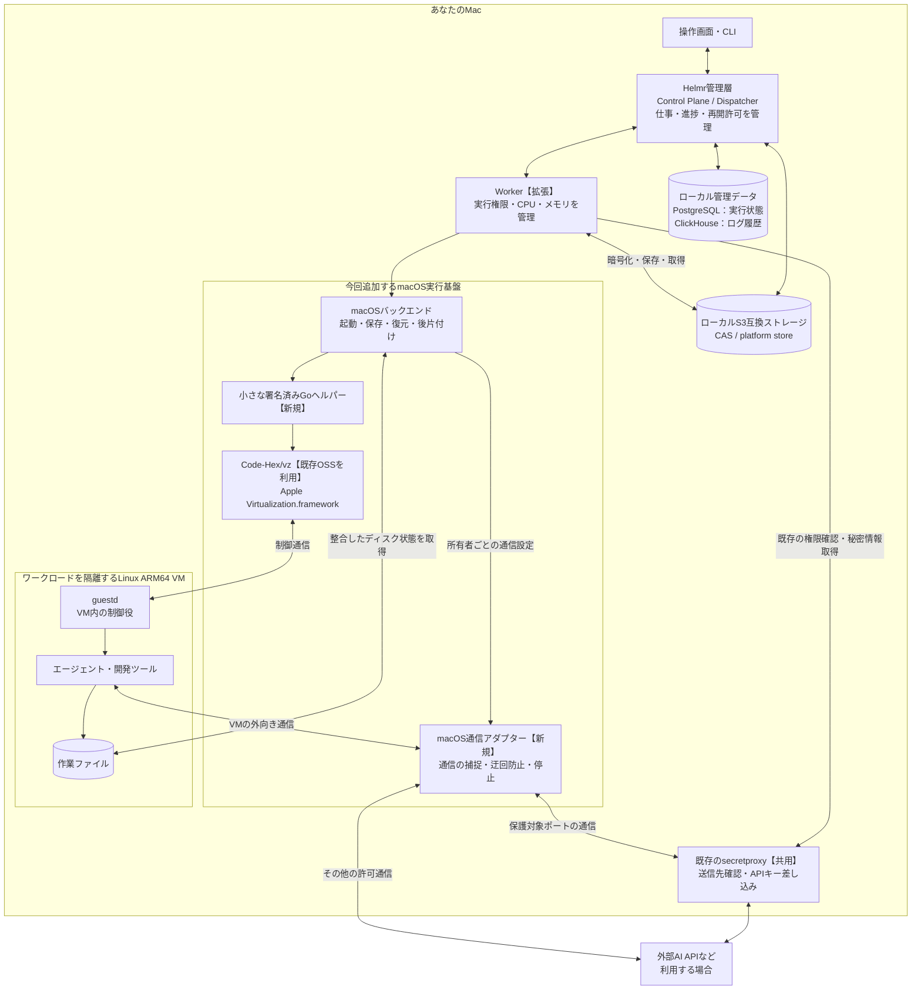
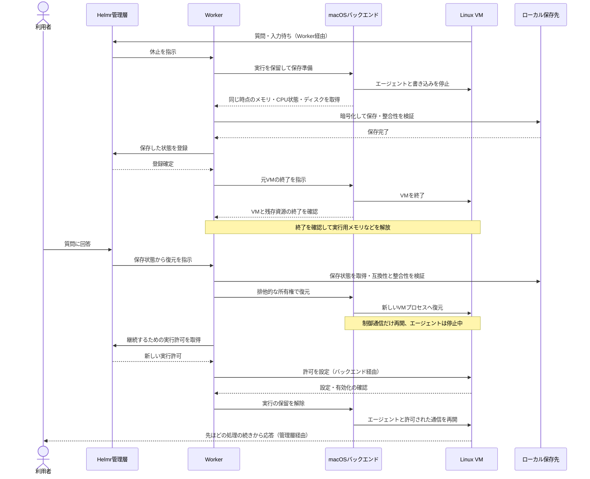

# macOS local runtime proposal

Status: native checkpoint experiment, Unix NBD/LocalVersion adapter and ARM64 guestd build implemented; full macOS Worker remains incomplete. See [current evidence](../implementation/macos-host-safety.md#checkpoint-and-disk-integration-2026-10-15).
Baseline: upstream `2148c4416c4ea16e81218043af79b3f3d523fed7`.

## Outcome and acceptance boundary

Run the Console, CLI, Control Plane, Dispatcher, storage services, image builds,
and real task/agent execution on one Apple Silicon Mac. An agent can ask for
input, release its running VM, and later continue the same process state after
the Worker restarts. No AWS account, remote execution host, or paid model call
is required for the acceptance fixture. Networking and third-party model
credentials remain optional user configuration.

Preserve the existing execution, authority, storage, and secret-delivery
semantics. A subprocess runner or disk-only restart does not meet this goal.
Linux Firecracker remains supported. Qualification targets M1, M3-equipped
Macs, and Apple Silicon Mac mini models. Intel Mac execution and migration
between Macs are separate, unproven capabilities. Their absence must be visible
at admission.

### Hardware qualification targets

| Target | Required qualification | Current evidence |
| --- | --- | --- |
| M1 Max reference Mac | Full lifecycle and fault suite on its recorded chip/OS/RAM configuration | 20/20 repaired LocalVersion synthetic checkpoint cycles passed; no full Worker qualification |
| M3-equipped Mac | Same native arm64 backend; full lifecycle and fault suite on the actual model | Not run; exact model, RAM and macOS to be recorded |
| Apple Silicon Mac mini | Same native arm64 backend; qualify each claimed chip/OS/RAM configuration | Not run; exact model, chip, RAM and macOS to be recorded |

A result on one Mac does not establish support for another chip or every
Mac mini generation. Size concurrency and reservations from available memory,
CPU and disk; do not copy the 64 GiB reference host's capacity as a requirement
or a default. Validate single-VM operation and resource rejection on the
smallest memory configuration claimed as supported. Minimum RAM and supported
macOS versions remain qualification outputs. The local support matrix must
distinguish intended targets from verified configurations.

## Current coupling

| Surface | Current contract | Required work |
| --- | --- | --- |
| VM lifecycle | `internal/vm/machine.go` already defines materialization, restore, capture, and abort barriers | Implement these semantics for a second backend; reuse this boundary |
| Worker startup | `cmd/worker/run.go` directly constructs and qualifies Firecracker and reclaims Linux resources | Extract backend-owned qualification/recovery; retain shared reservations and authority |
| Runtime identity | `internal/vmplatform/identity.go`, `internal/workerapi/worker.go` include Firecracker-specific fields and accept x86_64 | Introduce a versioned backend-tagged selector and host-affinity constraints |
| Persistence | `internal/db/schema/migrations/000001_initial.up.sql` requires Firecracker identity columns | Add a new migration and regenerate queries/catalog; do not edit the initial migration |
| Guest artifacts | `images/`, `internal/definition/computer_spec.go`, compiler analysis, artifact ELF verification assume x86_64 | Produce and verify Linux arm64 boot/runtime/seed artifacts and OCI platforms end to end |
| Computer disk | `internal/disk/`, `internal/nbd/`, attachment recovery use Linux devices | Provide a macOS attachment implementation preserving the versioned disk capture contract |
| Network/secrets | `internal/secretproxy/` and Worker client own credential mediation; `internal/firecracker/` binds them to Linux namespaces, datapath and transparent routing | Reuse mediation and authority callbacks; adapt VM traffic capture, original-destination delivery, enforcement and cleanup to macOS |
| Local composition | `dev/local/start.sh` starts the Console/CP and backing services, requires S3 URIs, and synthesizes a descriptor | Add a complete local composition with real descriptors, Dispatcher and Worker; never reuse the synthetic descriptor for execution |

The work is not an architecture string replacement. The build/compiler,
artifact verifier, scheduler, database and checkpoint contracts all participate.

## Candidate selection and first experiment

Prefer a native arm64 Linux guest controlled by Apple's Virtualization.framework
(VZ), subject to the gates below. A small signed Go helper owns each VM through the existing
`Code-Hex/vz/v3` binding, pinned to v3.8.0 for the first experiment; Go retains
the existing worker protocols. One VM per short-lived helper isolates native
callback waits and finalizer-managed handles from the Worker. The supervisor
owns deadlines and quarantine; a timed-out binding call is not cancellation.
See the [OSS comparison](macos-runtime-oss.md) for reuse boundaries and the
[host safety implementation](../implementation/macos-host-safety.md) for gates.

Apple exposes save/restore on Apple Silicon starting with macOS 14. The API
requires a paused VM when saving and restores into a paused state. Save files
are tied to the originating host; software changes can make them incompatible.
The entire production device configuration must pass
`validateSaveRestoreSupport()`. API availability is insufficient evidence.

Alternatives are QEMU with HVF, and a Linux guest hosting another hypervisor.
Neither is selected as an automatic fallback. HVF migration/device support must
be qualified for the exact QEMU version and machine type. A nested Firecracker
route must prove usable KVM and the required architecture on M1; the existing
arm64 Docker VM does not supply either x86_64 execution or `/dev/kvm`.
Software emulation is an experimental fallback only, with explicit performance
and isolation evaluation; it is not evidence that native execution works.

Gate 0 is a standalone experiment, before modifying scheduler/schema contracts:

1. Pin kernel, initramfs, guestd, helper, boot configuration, OS and device list.
   Boot a minimal arm64 Linux VM with the intended block, control and network
   devices. Validate the configuration and save support, then exercise them.
2. Run a fixture that holds an unpredictable nonce and a counter only in RAM,
   keeps a child process and an open file descriptor alive, writes a sequenced
   disk journal, and communicates through the proposed guest control channel.
3. Freeze guest workload execution and device writes, pause, flush/capture all
   writable disks, save VM state, hash and seal the complete artifact set.
   No writable shared folder is allowed outside the captured device set.
4. Terminate the original helper; prove its VM and disk/network ownership are
   gone. Start a fresh helper and restore the captured VM and disks on the same
   Mac/user, still isolated and paused. Rebind control/network endpoints and
   allow only guest control until a fresh authority grant is installed.
5. Resume and verify the RAM nonce, child identity, descriptor offset, counter,
   journal and guest control channel. A cold-boot/init marker must remain at one.
   Check connection loss explicitly: existing external TCP sessions need not
   survive, but application reconnection must not replay a completed action.
6. Repeat 20 save/terminate/restore cycles and the critical fault tests. Measure
   cold boot, save, restore, disk bytes and peak host RAM; retain samples and
   p50/p95/max. Establish performance targets from these measurements before
   describing the runtime as fast or suitable for interactive use.

If the exact devices cannot be saved or reattached safely, Gate 0 fails.
Revisit the backend choice instead of weakening checkpoint behavior.

## Ownership and data flow

The proposed deployment below places execution and backing services on one Mac.
Labels distinguish the existing Worker to extend from the new macOS components.
Backing services and the image builder may use a dedicated local Linux VM, as
described in [Complete local composition](#complete-local-composition).

The helper alone holds VZ objects and device handles. Use a private, versioned
Unix-socket protocol with bounded frames, deadlines and an unpredictable
per-launch capability. Check peer identity and ownership; do not expose a TCP
management API. Paths are backend-created artifacts under a private state
directory, never arbitrary paths supplied by guest messages. Sign only the
helper with the virtualization entitlement. Guests receive no host workspace,
Docker socket, keychain or reusable host cloud credential.

The backend owns physical exclusion, disks, network and helper recovery. The
Worker owns workload authority, allocations, encryption and CP interactions.
The CP remains the authority for continuation and accepted checkpoint identity.
Neither a local journal nor a helper acknowledgment authorizes a workload to
run. Reuse `vm.WorkloadBinding` and existing grant/fence exchanges.

### Reuse existing secret mediation

macOS does not introduce a new secret policy. Retain the existing host-side
credential mediation so protected API keys stay outside the workload VM and
are resolved only for the authorized runtime and origin. Reuse
`internal/secretproxy/` for origin/TLS checks, header replacement, admission
bounds and cancellation, and
`internal/workerclient/secret_proxy_transport.go` for CP preparation and
resolution callbacks bound to the immutable instance identity. The proxy's
portable tests are useful regression coverage; this proposal does not claim
native macOS integration has been qualified.

The OS-specific part is the attachment and transport. Today,
`internal/firecracker/network_policy_linux.go` installs network namespaces,
TAP/datapath ownership, nftables and transparent routing;
`secret_egress_linux.go` creates the transparent listener. The macOS adapter
must deliver captured connections to the shared proxy with the same trusted
original numeric destination that `Proxy.Serve` expects in `LocalAddr`.
Destination metadata must come from the host-owned packet/connection binding,
never a guest-supplied proxy header. Installing an ordinary HTTP proxy and
setting guest environment variables does not enforce this contract.

The adapter also owns routing for non-captured allowed traffic, blocks bypasses,
and couples all paths to current owner/generation and VM lifecycle. Closing the
shared proxy remains part of fencing; the adapter must stop its other paths as
well. Qualify these boundaries before deciding whether any small transport
interface extraction is needed. Do not duplicate origin/credential policy in
a macOS-only implementation.

Networking must default to deny before guest execution. A VZ NAT attachment
alone is insufficient: qualify per-owner isolation, private/loopback/metadata
destination blocking, DNS and IPv6 handling, and origin-bound secret proxying.
Use an explicit host-side policy transport with no alternate guest route;
the selected transport is a Gate 0 experiment requirement. Re-enforce it before
restored workload execution. User-controlled guest firewall rules are not the
host security boundary. If enforcement dies, revoke egress and hold/terminate
the VM. Never advertise readiness while enforcement is unavailable.

## Checkpoint state and crash rules

The sequence shows successful suspension and resume. The Worker coordinates
storage publication and authority with the Control Plane; the backend owns
physical VM capture, restore and exclusion. Failure and ambiguous-response
behavior follows the state rules below and the
[fault-test specification](../testing/macos-runtime-faults.md).

The names below describe local design states, not new CP API statuses.

| State | Durable record / permitted work | Next step |
| --- | --- | --- |
| Running | Current owner, generation and host epoch; workload grant installed | Acquire existing lifecycle barrier |
| Holding | Member execution and device dispatch sealed; guest control only | Complete exact guest preparation exchange |
| Capturing | VM paused; matching disk generation retained; private temporary files | Serialize and seal one coherent cut |
| Sealed | Manifest, hashes, configuration and disk roots durable; still no adoption | Publish encrypted CAS objects |
| Adoption pending | Exact checkpoint identity submitted; response may be lost | Read/retry existing authority protocol with that identity |
| Adopted | CP confirmed adoption; original execution remains held | Prove physical exclusion, then release reservations |
| Restoring | Exclusive destination owner, verified artifacts; VM paused or guest-control-only | Install and acknowledge fresh continuation grants |
| Running again | Activation acknowledged for the new authority generation | Allow workload and authorized egress |

Use the existing checkpoint adoption/abort protocol. A capture failure retains
the reversible hold; `ResumeGuestControl` is not permission to run members.
Only the matching abort grants and guest acknowledgment permit `CompleteAbort`.
An ambiguous installation/activation response uses the existing continuation
fence; never convert uncertainty into permission or an automatic cold start.

Publish a single manifest referencing one cut of VM state, scratch disk and
Computer disk. Temporary artifacts are not discoverable as checkpoints.
Durably seal local metadata before publishing references; verify upload hashes
and CP adoption before deleting any recoverable cut. Keep snapshot buffers
within the existing encryption, capacity and retention accounting. A VZ save
file does not include external disks. Disk capture must preserve flush ordering
and exclude concurrent writers; APFS cloning alone does not prove this.

On startup, enumerate journaled helpers, live resources and ownership handles
before qualification. PID alone is insufficient. Hold unknown resources and
refuse admission until ownership/exclusion is resolved. A closed control socket
does not prove the VM died. Fence the exact owner/generation and retain disk
attachments until all consumers are absent. After a crash, reconcile the CP's
accepted identity before abort, restore or reclamation.

Restore compatibility includes backend, runtime artifact digests, architecture,
device/config digest, VCPU/memory shape, OS/runtime version, host identity and
user/key domain. Host identity is an opaque local installation identifier, not
a published hardware serial. It is a routing constraint, not cryptographic proof
that a VZ file can be opened. Reject mismatches before execution. Retain the
checkpoint and surface an actionable error; never silently reboot and rerun
agent initialization. Cross-host restore is not supported for the VZ backend.

## Implementation boundaries and compatibility

Use a backend-tagged, versioned runtime selector with shared artifact and shape
fields and a validated backend-specific payload. Keep existing Firecracker
selectors and IDs unchanged; do not put VZ values into Firecracker fields.
Add explicit checkpoint affinity to the persisted checkpoint identity and
scheduler admission. Unavailable or mismatched affinity means unschedulable,
with a visible reason, rather than scheduling to another host.

Before adding fields, produce an API/schema inventory covering Worker
activation, CPU environment digests, pool matching, checkpoint manifests,
database constraints, generated queries and Console types. Add migrations with
old-row backfill and mixed-version rejection tests. Existing Firecracker IDs
must still validate byte-for-byte. Unknown backend/version is rejected. New
backend enablement requires compatible CP, Dispatcher and Worker versions.

Checkpoint object layout is also part of Gate 1. Shared publication and
validation currently require Firecracker state, memory and scratch roles in
`internal/computercheckpoint/manifest.go`,
`internal/computerhost/allocation_checkpoint.go`, and
`internal/computer/checkpoint.go`. VZ produces opaque saved state; do not label
it as a Firecracker state/memory object or assume the existing state-size limit
can hold it. After Gate 0 establishes the actual artifact shape, define a
versioned backend-specific layout, media types, manifest validation and bounded
size accounting for the opaque VM state and external disks. Update CP
validation, encrypted publication, reservation, retention and restore readers
together. Preserve the existing Firecracker object format and IDs. Gate 1
fixtures must cover valid VZ layout, missing/extra/wrong-role objects,
oversized state, wrong media types and mixed-version rejection.

Architecture flows explicitly from project/build target through compiler,
image resolution, seed format, ELF validation, boot/runtime descriptors and
Worker matching. Publish architecture-specific artifacts; reject an amd64-only
image on arm64 before preparation. Do not relabel existing x86_64 artifacts or
make Rosetta an implicit dependency. Application source and durable resources
can remain portable; live VM checkpoints are backend/architecture specific.

For the Computer disk, evaluate a userspace NBD endpoint consumed by VZ versus
an exclusively owned file attachment. Both must support the existing immutable
version capture, retention, capacity and recovery rules. Kernel `/dev/nbd*`
commands do not become no-ops on macOS. Prove reconnect and write ordering with
the full device set at Gate 0, then choose one implementation.

## Complete local composition

ClickHouse preserves the upstream historical-log path; it is not part of VM
state serialization. `internal/clickhouse/README.md` defines three histories:
session, image-build and Computer-command logs. PostgreSQL owns accepted chunks
and export claims; ClickHouse holds their historical projection, and its
acknowledgment permits retiring the accepted chunks. Deployment events remain
in PostgreSQL. The CP reads historical logs from ClickHouse, and the Dispatcher
exports them. Both currently require ClickHouse configuration, so removing it
from the full local stack requires an explicit storage/reader/export redesign.
The standalone Gate 0 VM experiment does not require ClickHouse. Measure its
idle/load memory and backlog behavior alongside the other services on each
target configuration before setting the full-stack minimum memory requirement.

Provide a separate local launcher after backend qualification. It owns and
stops only its own PostgreSQL 18, ClickHouse, S3-compatible service, CP,
Dispatcher and Worker. Dependencies may run inside a dedicated arm64 Linux VM;
the execution VMs run directly through the macOS backend, without nested KVM.
Build arm64 OCI images in a bounded local Linux builder using pinned tools.
Reuse existing S3 and artifact APIs: separate CAS/platform buckets, real
runtime descriptors, no fake execution metadata or dependency on AWS IAM.

Gate local S3 on the immutable write/read, range, listing, retry and consistency
behaviors actually used by the stores. Use dedicated local credentials, loopback
ports and private volumes. Readiness requires migrations, valid artifacts,
successful Worker qualification, capacity, and Dispatcher operation. Startup
failure unwinds owned services; it must not stop an existing Docker/Lima VM.
Reuse supported local authentication with loopback-only endpoints; external
OAuth/model/Slack setup is optional and never needed by deterministic tests.

## Delivery gates

| Gate | Reviewable result | Required evidence |
| --- | --- | --- |
| 0 | Standalone native VM experiment and device/network choice | Same-process-state restore across helper death on M1; coherent disks and control transport; critical fault tests |
| 1 | Backend identity, architecture, checkpoint layout and affinity contracts | Compiler/artifact/API/DB fixtures, object-role/media-type/size tests, migration and scheduler mismatch tests; unchanged Firecracker IDs/formats |
| 2 | Native backend and host recovery | Existing lifecycle semantics, fencing, network/secret isolation and all applicable fault tests |
| 3 | Full local composition | Clean-machine local start/stop, real build/deploy/run/ask/resume with no remote host or paid API |
| 4 | Upstream contribution | Reviewed implementation, Linux regression evidence and documented macOS limits |

These are sequential acceptance gates, not a preapproved stacked-PR plan.
This PR contains the design, full-runtime fault specifications and a bounded
standalone safety probe using an existing OSS binding. No full gate has passed.
Further implementation must prove the next gate before advertising complete
macOS support.

## Evidence and open decisions

The current [probe evidence](../implementation/macos-host-safety.md#validation-evidence-2026-10-15)
records the Linux kernel reaching its `/init` execution attempt, fixed-volume exhaustion, controller-death
admission rejection and verified cleanup through the signed Go helper. These
results do not establish a coherent checkpoint or a running Helmr Worker.

The earlier API-only baseline on the M1 Max/macOS 26.6.2 host used a signed, minimal Linux VZ
configuration that passed configuration validation and save/restore support
validation. It used `/dev/null` as a kernel path and did not boot a guest or
include production devices. This proves only that the API-level capability
probe succeeds; it does not prove that a Linux workload can be restored.
The existing arm64 Lima VM reported no `/dev/kvm`.

Open at Gate 0: exact device and egress transport, recoverable Computer disk
attachment, guest control rebind after restore, artifact sizes, performance,
and packaging/signing minimum OS. macOS 14 is the API availability floor, not
a tested minimum OS claim. The checkpoint host/user affinity is a documented
limitation of this candidate, not a claim of cross-host feature parity.

Design review must explicitly evaluate security and failure behavior. Local
fakes verify protocol ordering; only physical Mac runs establish VM support.
See [the fault-test specification](../testing/macos-runtime-faults.md).

## Primary references

- [Apple Linux virtualization](https://developer.apple.com/documentation/virtualization/virtualize-linux-on-a-mac)
- [Validate save/restore configuration](https://developer.apple.com/documentation/virtualization/vzvirtualmachineconfiguration/validatesaverestoresupport())
- [Save VM state](https://developer.apple.com/documentation/virtualization/vzvirtualmachine/savemachinestateto(url:completionhandler:))
- [Restore VM state](https://developer.apple.com/documentation/virtualization/vzvirtualmachine/restoremachinestatefrom(url:completionhandler:))
- [Apple save/restore and external storage explanation](https://developer.apple.com/videos/play/wwdc2023/10007/)
- [QEMU arm virt machine and compatibility](https://www.qemu.org/docs/master/system/arm/virt.html)
- [QEMU security boundary](https://www.qemu.org/docs/master/system/security.html)
