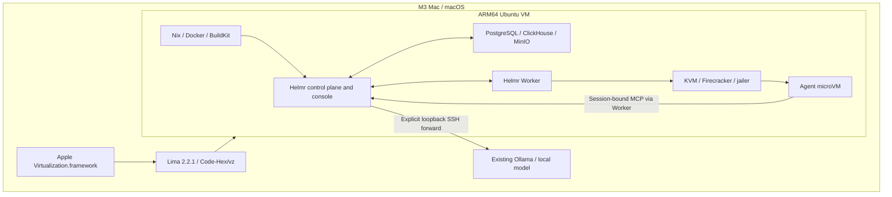

# macOS runtime through Lima: experimental setup

Status as of 2026-10-20: the remote M3 Max runs a real control plane, console,
storage services and qualified Worker inside an ARM64 Linux VM. A deployed Agent
has completed local-model inference, durable result publication, RAM checkpoint
restore, and an ask/answer Turn with its original process state retained. This is
not a complete installation guide or a supported macOS release.

## Architecture and dependency ownership



The original Helmr Worker uses Linux/KVM/Firecracker. Lima was installed for
this macOS adaptation; it was not an existing Helmr runtime dependency. Homebrew
records installation of Lima 2.2.1 on the test Mac on 2026-10-20. Lima's VZ driver
uses [Code-Hex/vz](https://github.com/Code-Hex/vz); see its
[versioned dependency list](https://github.com/lima-vm/lima/blob/v2.2.1/go.mod).
Apple's framework starts the outer VM; nested virtualization exposes KVM to
Linux so that Firecracker can start the inner Agent microVMs.

| Component | Purpose and origin |
| --- | --- |
| Apple Virtualization.framework | macOS-provided outer virtualization |
| Lima 2.2.1 | Added to the Mac for this adaptation; manages the outer Linux VM and SSH access |
| Ubuntu 26.04 ARM64 | Outer Linux guest; provides KVM, cgroup v2, NBD and network isolation facilities |
| Firecracker 1.17.0 and jailer | Existing Helmr isolation technology, using its ARM64 binaries for this experiment |
| Nix | Builds verified runtime, builder image and Worker tools with pinned inputs |
| Docker and BuildKit | Build Agent deployment bundles; run inside the outer Linux VM |
| PostgreSQL 18.4 / ClickHouse 26.7.5.10 / MinIO | Local state, logs and S3-compatible storage; no cloud storage account required |
| Go 1.27.1 / Bun 1.3.13 / Node 24.21.0 / apko | Build tools used in the Linux experiment |
| Ollama | Already installed on the Mac; direct inference and deployed Agent inference verified |

The separate [native VZ experiment](../../dev/macos/README.md) invokes vz directly
to test VM state and disk transport. Its passing checkpoint tests do not prove
the nested Worker path, and the nested Worker does not use that native helper.

## Outer VM setup

The tested host is an M3 Max with 128 GiB RAM and macOS 27.0.1. This does not
establish compatibility with every Apple Silicon Mac. Nested virtualization
support and an actual usable `/dev/kvm` are required; an ordinary ARM Linux VM
without KVM cannot run this Worker.

Install Homebrew separately if needed, then install Lima on the Mac:

```sh
brew install lima
limactl --version
```

The tested version is 2.2.1; the Homebrew command installs the version currently
available, not necessarily that version. Use a dedicated Lima directory and the
[checked-in VM configuration](../../dev/macos/lima.yaml) from the repository root:

```sh
export LIMA_HOME="$HOME/helmr-local/lima"
mkdir -p "$LIMA_HOME"
limactl start --name=helmr-linux dev/macos/lima.yaml
limactl shell helmr-linux uname -m
limactl shell helmr-linux ls -l /dev/kvm
limactl shell helmr-linux stat -fc %T /sys/fs/cgroup
```

Expected results are `aarch64`, an existing KVM device, and `cgroup2fs`. Device
existence alone does not prove access or Firecracker compatibility; qualification
must run before admitting work. The YAML is extracted from the running test VM's
settings and pins its Ubuntu image digest. Starting a fresh VM from this reduced
file has not yet been independently repeated.

The outer VM has 4 vCPUs, 12 GiB RAM and a 160 GiB virtual disk. These are test
allocations, not product minimum requirements. `mounts: null` disables host
directory shares, `plain: true` disables Lima convenience integrations, and
Lima-managed containerd is disabled. Source is copied explicitly; Docker runs
inside Linux. No host SSH-agent forwarding or automatic application-port
forwarding is used.

## Linux setup and service boundaries

Creating the outer VM is only the first step. The current experiment additionally
requires the following Linux-only setup, which is not yet packaged as a complete
bootstrap command:

1. Install Nix and Docker/Buildx and copy the Helmr checkout into Linux.
2. Build ARM64 boot artifacts, verified runtime, bundle builder and Worker tools.
3. Create dedicated VMM and verifier users, private state directories, KVM device
   permissions, delegated cgroups, and an explicit NBD device allowlist.
4. Configure the Linux network namespace, nftables/TPROXY and forwarding used by
   the existing Worker isolation. Keep metadata-address blocking and secret proxy
   policy intact.
5. Start loopback-only PostgreSQL, ClickHouse and MinIO, with separate CAS and
   versioned platform buckets. Generate local credentials into private files.
6. Start the real development control plane with seed fixtures disabled and a
   verified runtime descriptor. Enroll and qualify the Worker, then use a dedicated
   test environment for deployments.

Service ownership is explicit: `helmr-console`, `helmr-worker` and `helmr-minio`
are experiment-owned systemd units inside Linux. The Worker requires Linux root
for its existing jailer/network/storage setup; this does not require a macOS root
service. No host firewall change, public application listener or paid model API
is needed. Private credentials, machine addresses and enrollment tokens must not
be copied into this document or GitHub.

The acceptance deployment is in **M3 Local / Mac Test**, not the empty local
Production Environment. Select Mac Test in the console before inspecting Agents
or deployments. `No current deployment` in Production does not describe Mac Test.

The console listens on Linux loopback port 13000 and the control plane on 18080.
Use explicit SSH local forwards to reach them from the Mac; for a second Mac,
forward through its existing SSH connection too. The local developer login is a
development-only entry point. Do not expose this stack as a public service.

## Verification and remaining work

| Gate | Current result |
| --- | --- |
| Nested Firecracker RAM checkpoint, original process exit, fresh-process restore | Passed in the M3 Linux VM using a dedicated fixture; not an Agent test |
| ARM guest boot artifacts and verified runtime / builder / Worker builds | Passed with the ARM64 source changes on this branch |
| Worker qualification | Passed, including verifier, cgroups, isolation and jailed guest health |
| Real control plane, Worker, console and storage services | Running; rechecked 2026-10-20 |
| Agent bundle and deployment | Built, verified, finalized and promoted in the local Mac Test Environment |
| Existing Mac-local model | Deployed Agent received Japanese responses from the existing Ollama `qwen3.8:27b` model |
| Agent ask and RAM resume | Passed after source VM termination: question answered, next Turn completed, same RAM marker/PID/init count and increasing Turn count |
| Control plane and Nix-built Worker restart | Passed: same Session resumed from RAM and completed Turn 3 with the original process state |
| Fresh-checkout full setup and long-duration coexistence | Not accepted |

The branch includes ARM64 Firecracker identity, CPU evidence, schema, boot-image,
Nix, CLI and allocation changes. Admission, allocation, preparation delivery and
boot compare the admitted seed architecture with the selected platform. Unknown
profiles and cross-architecture assignments remain rejected.

The optional local-model gateway is wired only into the development control
plane. It is scoped to one explicitly configured Environment and an exact
running Turn, reuses authenticated MCP/vsock transport, and checks execution
authority before, during and after inference. It allows one fixed model, literal
loopback HTTP, one concurrent call and bounded prompt/response/deadline values.
It rejects redirects and ignores HTTP proxy environment variables. In-flight HTTP
cancellation does not establish immediate cessation inside the model server.

The [Agent example](../../examples/mac-local-model/README.md) closes its MCP HTTP
connection and clears its timer before completing a Turn. The earlier fetch-based
example left asynchronous resources that delayed RAM capture; it was replaced
rather than exempting those resources from the checkpoint verifier. The Worker
must retain the existing static `CGO_ENABLED=0` build contract: a dynamic ad-hoc
build cannot perform the verifier's all-thread privilege changes.

See the [sanitized M3 acceptance record](../testing/evidence/macos-m3-local-model.json)
for the exact evidence scope. Initial VM construction and full service bootstrap
still need an independently repeated fresh-checkout procedure before this can be
presented as a complete installer.
